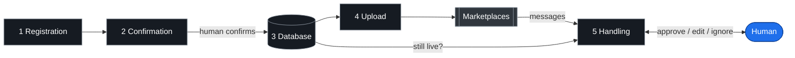

# secondhand-ops

Second-hand marketplace ops, end to end: **materials in → listings out → buyer
conversations handled → item marked sold**, with a human approving anything that
reaches a stranger.

Built for DBA.dk and Facebook Marketplace. Provider-agnostic by construction — a
new marketplace is one file per stage, never a change to the pipeline.

→ **Read [`docs/architecture.md`](docs/architecture.md) first** — the mermaid
diagrams, stage contracts, and a worked example from a real sale.
→ **Then [`docs/ONBOARDING.md`](docs/ONBOARDING.md)** — the 20-minute reading
order, the seven invariants, and exactly what is still unimplemented.

### Verify it in one command

```bash
python3 tests/test_invariants.py     # no network, no marketplace, no deps
```

---

## Layout — directories are diagram nodes

Every directory under `src/` is a node in the architecture diagram, and the names
match exactly:

```
src/
├── intake/         voice memo · photo · text  →  structured item folder
├── catalog/        item folders  →  catalogue + wheelset relations
├── publishing/     catalogue  →  live ads on DBA / Facebook
├── conversations/  buyer messages  →  draft  →  approve  →  send  →  verified
├── registry/       the seam: items.json (writer) + Notion mirror
└── auth/           marketplace sessions — human logins only
bin/                thin entry points (msgctl, listctl, msg_poll.sh)
docs/               architecture, DBA API facts, delivery routing
examples/           account config, registry rows, three worked item folders
tests/
```

`src/conversations/registry.py` is a **read-only** door to the seam; the store
itself lives in `src/registry/registry.py`. Messaging never writes it — a
messaging mistake talks to a stranger, a listing mistake mis-prices an ad, so the
two must be able to fail separately.

---

## The pipeline



Full diagram, per-stage contracts and the conversations state machine:
[`docs/architecture.md`](docs/architecture.md).

---

## Quickstart

```bash
pip install -r requirements.txt

# 1. who you are on the marketplace (the id appears in the conversation URL)
cp examples/dba_account.example.json src/conversations/dba_account.json

# 2. log in by hand once, then export the cookies
python3 src/auth/login_marketplace.py
python3 bin/msgctl auth

# 3. first poll PRIMES — records history, queues nothing — then stays silent
python3 bin/msgctl poll
```

Full prerequisites: [`SETUP.md`](SETUP.md).

### Daily use

```bash
python3 bin/msgctl pending               # buyers who spoke last (JSON)
python3 bin/msgctl unanswered --days 14  # we spoke, nobody answered
python3 bin/msgctl draft --conv <id> --body-file /tmp/b.txt --inbound "<theirs>"
python3 bin/msgctl show --id 7           # exactly what the human sees
python3 bin/msgctl approve --id 7 --action send|ignore|supersede --by Jacob
```

---

## Guarantees that are code, not intentions

- **Approval gate** — a draft leaves `pending` exactly once; deciding twice is refused, so a retry cannot double-send.
- **Verified delivery** — after sending, the marketplace API is re-read and the message must be the last outgoing one. A 200 is not proof.
- **No auto-retry on an unverified send** — a retry can duplicate a message to a real person.
- **Idempotent polling** — stable content hashes; a message never queues twice.
- **Prime on first run** — history is never announced as news.
- **No login automation, ever** — session expiry raises and waits for a human.

---

## Status

| stage | DBA | Facebook |
|---|---|---|
| intake | works (local Whisper, no API key) | n/a |
| catalog | works | n/a |
| publishing | works | stub + notes |
| conversations | **read via JSON API, send verified** | stub + notes |
| registry | works | works |

DBA sending is HTTP-capable (`--via http`); the DOM path stays the default until
one HTTP send is verified in production. See [`docs/DBA-API.md`](docs/DBA-API.md)
for the endpoint and the three rules for trusting a send.

## License

MIT.
