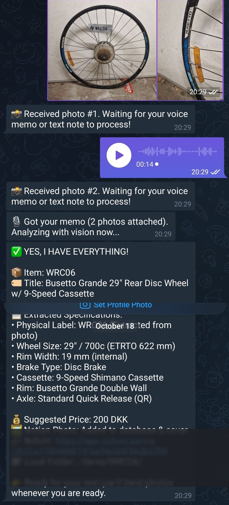
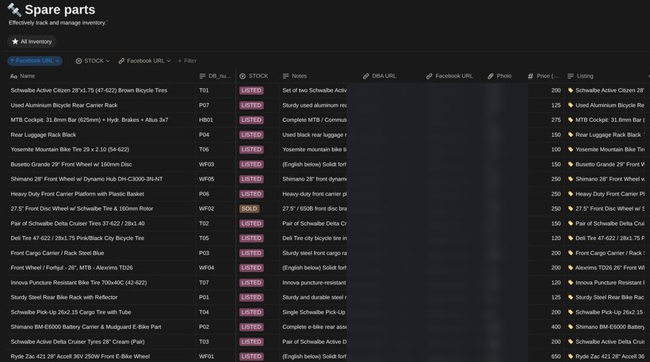
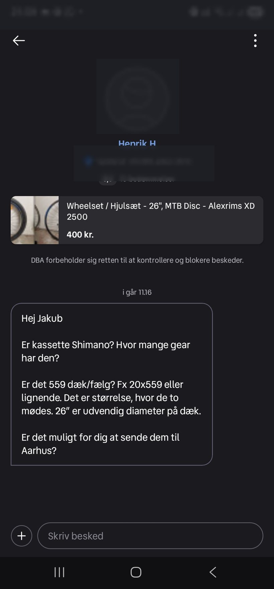
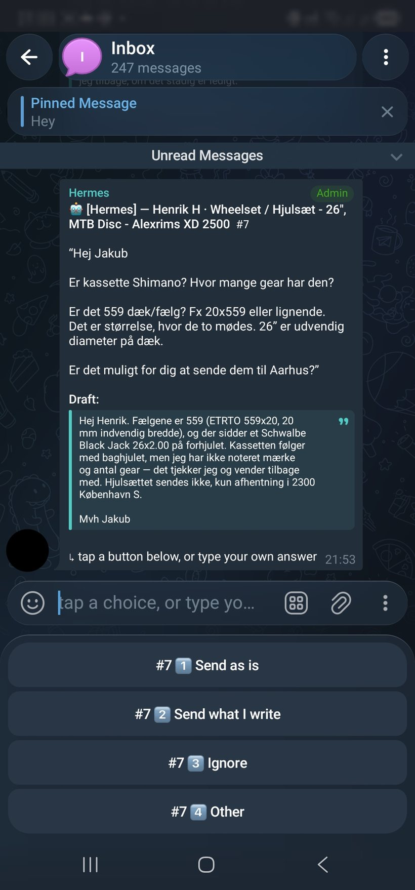
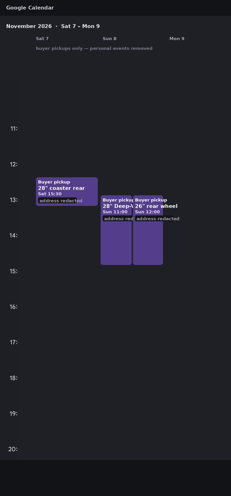
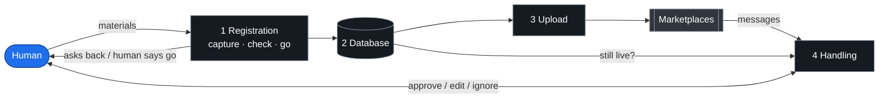

# secondhand-ops

**One person's second-hand bike-parts business, run as a pipeline.**

Photograph a wheel, say what you know about it in a voice memo. It becomes a
structured record, a marketplace listing, a conversation with a buyer, an
appointment in the calendar — and finally *sold*, everywhere at once. The only
thing a model is trusted with is wording; every send, every state change, and every
price is deterministic, and nothing reaches a stranger without a human tap.

---

## What it looks like

### 1 · Registration — photos and speech in, a structured record out

Send two photos of the part and a 14-second voice note. The harness reads the
physical label off the photo (`#WRC06`), identifies the rim from the branding,
decodes the spec sheet — 29"/700c ETRTO 622, 19 mm internal, disc, 9-speed Shimano
cassette, double-wall, QR — and proposes a price. It stops and asks for confirmation
rather than guessing when a field is missing.



### 2 · Database — one row, and it is the source of truth

The record lands in a Notion table: name, DB number, stock state (`LISTED` / `SOLD`),
spec notes, the DBA and Facebook URLs, photo, price. Every later stage reads this
row rather than remembering anything.



### 3 · Publishing — the same record becomes ads

Listings are generated from the record and posted to DBA and Facebook Marketplace,
with the URLs written back into the row above.

### 4 · Conversations — a buyer writes, you get a card

A buyer asks about a wheel. The lane polls the marketplace in the background, drafts
a reply, and delivers it to Telegram with the question, the draft, and four choices.
**Drafting is the only step that costs a model call**; polling, delivery and sending
are scripts.




The four options are shortcuts, not a closed set — anything typed is an instruction.
Sending is verified against the marketplace afterwards: the ad must actually show
your text, because an HTTP 200 is not a delivery.

### 5 · Agreement — the pickup goes in the calendar

When a time is agreed, the reply carries the address and phone number in the buyer's
language, and the pickup becomes a calendar entry so it cannot be forgotten.



### 6 · Sold — one confirmation, every surface updated

After the visit you confirm it sold. The ad is marked sold on the marketplace, the
row flips to `SOLD`, and any wheelset it belongs to cascades with it.

---

## Where it actually stands

Honest labels, because a pipeline diagram that promises more than the code does is
worse than no diagram:

| Stage | State |
|---|---|
| Intake, extraction, pricing suggestion | **live** |
| Notion record + local item folder | **live** |
| Publishing to DBA and Facebook | **live** |
| Buyer conversations on DBA → Telegram → verified send | **live** |
| Calendar entries for agreed pickups | **live** |
| Mark-sold cascade (marketplace + database) | **live** |
| Buyer conversations on **Facebook Marketplace** | **not built yet** — `src/conversations/providers/fb.py` is a documented stub with the interface already pinned |

Built for DBA.dk and Facebook Marketplace. Provider-agnostic by construction — a
new marketplace is one file per stage, never a change to the pipeline.

→ **Read [`docs/architecture.md`](docs/architecture.md) first** — the mermaid
diagrams, stage contracts, and a worked example from a real sale.
→ **Then [`docs/ONBOARDING.md`](docs/ONBOARDING.md)** — the 20-minute reading
order, the seven invariants, and exactly what is still unimplemented.

### Verify it in one command

```bash
python3 tests/test_invariants.py     # no network, no marketplace, no deps
```

---

## Layout — directories are diagram nodes

Every directory under `src/` is a node in the architecture diagram, and the names
match exactly:

```
src/
├── intake/         voice memo · photo · text  →  structured item folder
├── catalog/        item folders  →  catalogue + wheelset relations
├── publishing/     catalogue  →  live ads on DBA / Facebook
├── conversations/  buyer messages  →  draft  →  approve  →  send  →  verified
├── registry/       the seam: items.json (writer) + Notion mirror
└── auth/           marketplace sessions — human logins only
bin/                thin entry points (msgctl, listctl, msg_poll.sh)
docs/               architecture, DBA API facts, delivery routing
examples/           account config, registry rows, three worked item folders
tests/
```

`src/conversations/registry.py` is a **read-only** door to the seam; the store
itself lives in `src/registry/registry.py`. Messaging never writes it — a
messaging mistake talks to a stranger, a listing mistake mis-prices an ad, so the
two must be able to fail separately.

---

## The pipeline



Full diagram, per-stage contracts and the conversations state machine:
[`docs/architecture.md`](docs/architecture.md).

---

## Quickstart

```bash
pip install -r requirements.txt

# 1. who you are on the marketplace (the id appears in the conversation URL)
cp examples/dba_account.example.json src/conversations/dba_account.json

# 2. log in by hand once, then export the cookies
python3 src/auth/login_marketplace.py
python3 bin/msgctl auth

# 3. first poll PRIMES — records history, queues nothing — then stays silent
python3 bin/msgctl poll
```

Full prerequisites: [`SETUP.md`](SETUP.md).

### Daily use

```bash
python3 bin/msgctl pending               # buyers who spoke last (JSON)
python3 bin/msgctl unanswered --days 14  # we spoke, nobody answered
python3 bin/msgctl draft --conv <id> --body-file /tmp/b.txt --inbound "<theirs>"
python3 bin/msgctl show --id 7           # exactly what the human sees
python3 bin/msgctl approve --id 7 --action send|ignore|supersede --by Jacob
```

---

## Guarantees that are code, not intentions

- **Approval gate** — a draft leaves `pending` exactly once; deciding twice is refused, so a retry cannot double-send.
- **Verified delivery** — after sending, the marketplace API is re-read and the message must be the last outgoing one. A 200 is not proof.
- **No auto-retry on an unverified send** — a retry can duplicate a message to a real person.
- **Idempotent polling** — stable content hashes; a message never queues twice.
- **Prime on first run** — history is never announced as news.
- **No login automation, ever** — session expiry raises and waits for a human.

---

## Status

| stage | DBA | Facebook |
|---|---|---|
| intake | works (local Whisper, no API key) | n/a |
| catalog | works | n/a |
| publishing | works | stub + notes |
| conversations | **read via JSON API, send verified** | stub + notes |
| registry | works | works |

DBA sending is HTTP-capable (`--via http`); the DOM path stays the default until
one HTTP send is verified in production. See [`docs/DBA-API.md`](docs/DBA-API.md)
for the endpoint and the three rules for trusting a send.

## License

MIT.
