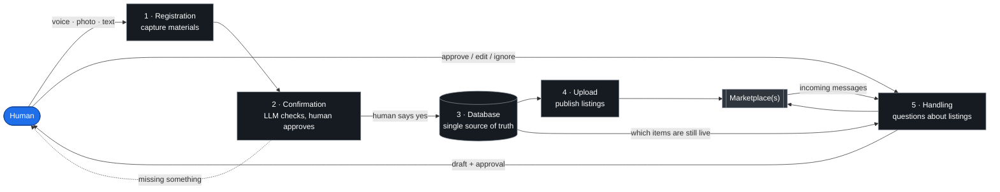
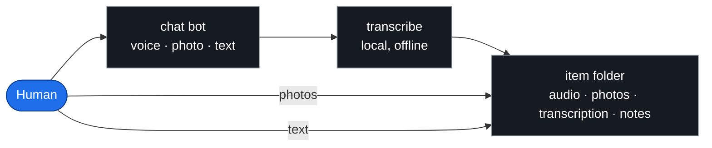
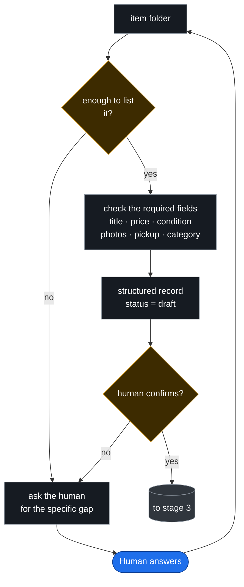
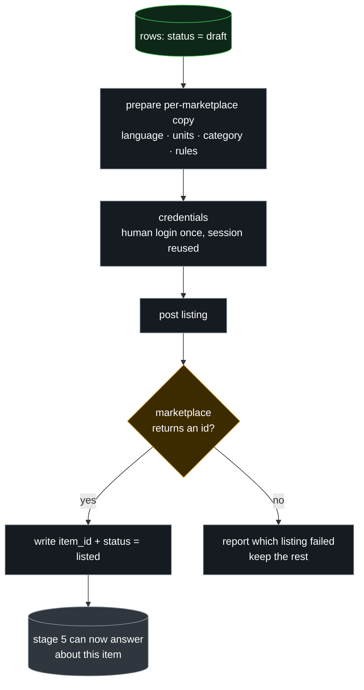
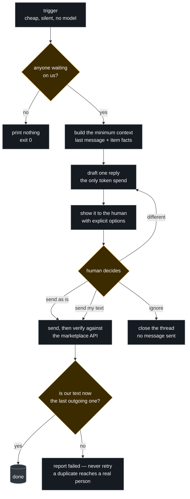
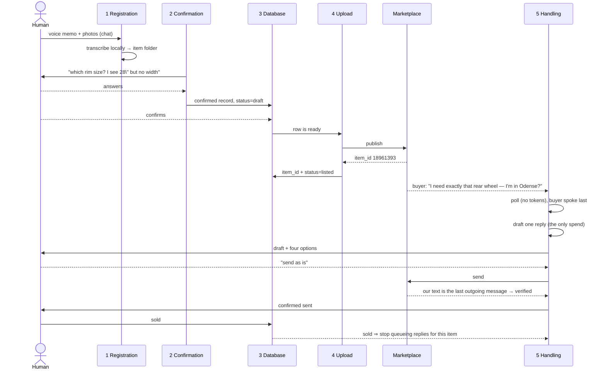

# Architecture

How materials become listings, and how messages about those listings get answered
without a human typing every reply.

**The top diagram has five stages.** Each stage boundary marked `║` in the
diagram is a section below, where that stage is opened up. Names in the top
diagram are **generic** — no marketplace, chat app or database is named there.
Every section then says *"in this implementation"* and names the exact scripts,
because the abstractions are only useful if the concrete version is one step away.

---

## 0. Overall architecture

Read it as: **the human only ever does two things — hand over materials, and
approve what leaves.** Everything between is mechanical and deterministic, which
is why it can be scripted; the two points where judgement is required are the two
places an LLM is allowed to spend tokens.

| stage | input | output | judgement? |
|---|---|---|---|
| 1 Registration | voice, photos, text | raw materials per item | no |
| 2 Confirmation | raw materials | a checked record, or a question back | **LLM** |
| 3 Database | checked record | one row, atomic, readable by everything | no |
| 4 Upload | rows marked ready | live listings with external ids | no |
| 5 Handling | incoming messages | replies, only after approval | **LLM** |

**Where the borders are:** each `→` in the top diagram is a hard boundary — a
file, a row, or a message. Never a function call. A stage can be rewritten,
restarted or replaced without touching its neighbours, which is what lets a
friend swap one marketplace and keep the rest.

---

## 1. Registration — capture materials

**Contract:** one item = one folder. Nothing is interpreted here — no prices, no
titles, no guessing. If the human sends three photos and a voice memo, that is
exactly what lands on disk.

> **In this implementation:** the human messages a Telegram bot with voice notes,
> photos or text. `src/intake/transcribe.py` runs Whisper locally (CPU, no API
> key, no upload) and writes `transcription.txt` next to the audio. A worked
> example folder is committed at `examples/items/P01/`.

---

## 2. Confirmation — the LLM checks, the human decides

**Contract:** this is the first place tokens are spent, and the only place where
the human is asked a question about an item. The required-fields list is
**configuration, not prompt text** — a marketplace that needs different fields
changes the list, not the model.

**Why the human confirms:** an LLM can misread a size, a groupset, a
compatibility. Those errors are cheap to catch now and expensive after a buyer
has driven across town.

> **In this implementation:** the agent that owns the chat bot reads the folder,
> extracts title/price/specs, and asks for anything missing. The field list lives
> with the catalogue stage (`src/catalog/`), and the human's confirmation is a
> plain reply in the same chat — no forms, no UI.

---

## 3. Database — one row, one truth

**Contract — the join key is `(provider, item_id)` and nothing else.** Not a URL,
not a title: those change or duplicate. Statuses are exactly five words —
`draft · listed · reserved · sold · withdrawn` — and an unknown status fails
**open** for messaging (answer anyway) and **closed** for selling (never double-sell).

**Writes happen in one place only.** Every other stage reads. That asymmetry is
what makes the whole thing debuggable: if a row is wrong, one writer wrote it.

> **In this implementation:** the source of truth is a Notion page database,
> mirrored into `items.json` by `src/registry/notion_ssot.py`; the store itself
> is `src/registry/registry.py`, writing atomically via `os.replace` so a reader
> sees either the old file or the new one, never half a row. Stage 5 gets a
> **read-only** door to it (`src/conversations/registry.py`) — the messaging side
> is structurally incapable of writing the seam.

---

## 4. Upload — put it on the marketplace and get an id back

**Contract:** `item_id` is usually **only known after publishing** — the
marketplace assigns it. Until then the row has no join key, and stage 5 must skip
it rather than guess which item a buyer means.

Two rules that cost real money to learn: publish in a batch but **record per
listing**, so one failure does not orphan the others; and never claim a listing
exists because a request returned success — re-read it.

> **In this implementation:** `src/publishing/batch_publisher.py` posts to DBA and
> Facebook through `src/publishing/providers/`. Credentials come from a **human
> login done once** in a headed browser (`src/auth/login_marketplace.py`), then a
> cookie jar imported by `src/auth/import_cookies.py`; no credential is ever
> automated. DBA returns `itemInfo.itemId`, which is written straight back into
> the registry. Live-ad repairs are `fix_past_dba_listings.py` and
> `update_crosslinks_dba.py`.

---

## 5. Handling — messages in, approved replies out

**Contract:** the human is the only sender. The system's job is to make deciding
fast — a draft, the context, four options — and to prove what actually left.

> **In this implementation:** `src/conversations/poll.py` is the trigger; drafts
> and approvals go through `src/conversations/msgctl.py`, and replies are handed
> to the human on Telegram by `notify.py` with the four options
> `1 send as is · 2 send what I write · 3 ignore · 4 other`. Sending is
> `providers/dba.py::send`, and it verifies by re-reading the API — a 200 is not
> accepted as proof. Exact endpoints and the three rules for trusting a send are
> in [`DBA-API.md`](DBA-API.md).

---

## 6. Why this burns few tokens

The design rule: **anything deterministic is a script; the model only judges.**

| step | cost | how |
|---|---|---|
| trigger | **0** | one authenticated HTTP GET, prints nothing when nothing is new |
| change detection | **0** | a hash of the trigger's own output — identical output means the agent never wakes |
| dedupe | **0** | content hashes in SQLite, so a re-poll cannot re-queue |
| state | **0** | SQLite; nothing lives in a prompt, no context is re-sent to remember |
| draft | **one short call** | only the last message plus the item facts, not the whole history |
| approval | **0** | four fixed options; the human's answer is routed by a state machine, not by parsing prose |
| send + verify | **0** | HTTP request, then a read to confirm |

The expensive failure mode in systems like this is not the model — it is waking it
every few minutes to re-read the world. Here the world is polled by a script and
the model is woken only when the script's output *changes*.

---

## 7. Worked example — the bike parts, as actually sold

Real run, 2026-10-31. The generic stages from §0, with this implementation's names.

---

## 8. Where each stage lives

Directories are named after the stage they implement, so the diagram and the tree
agree. Two directories serve one stage where the work genuinely splits.

| stage | directories | entry points |
|---|---|---|
| 1 Registration | `src/intake/` | `transcribe.py` |
| 2 Confirmation | `src/catalog/` | `build_catalog.py`, `inventory_relations.py` |
| 3 Database | `src/registry/` | `registry.py`, `notion_ssot.py` |
| 4 Upload | `src/publishing/` | `listctl.py`, `batch_publisher.py`, `providers/` |
| 5 Handling | `src/conversations/` | `poll.py`, `msgctl.py`, `providers/` |
| credentials (cross-cutting) | `src/auth/` | `login_marketplace.py`, `import_cookies.py` |

Adding a marketplace touches `providers/` in stages 4 and 5 and nothing else.
