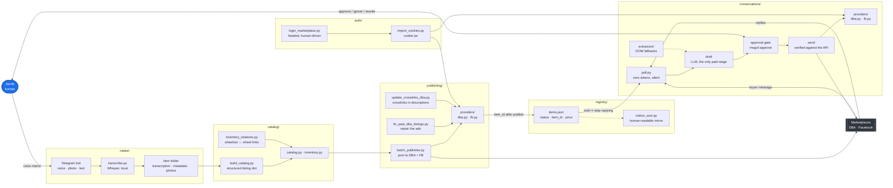
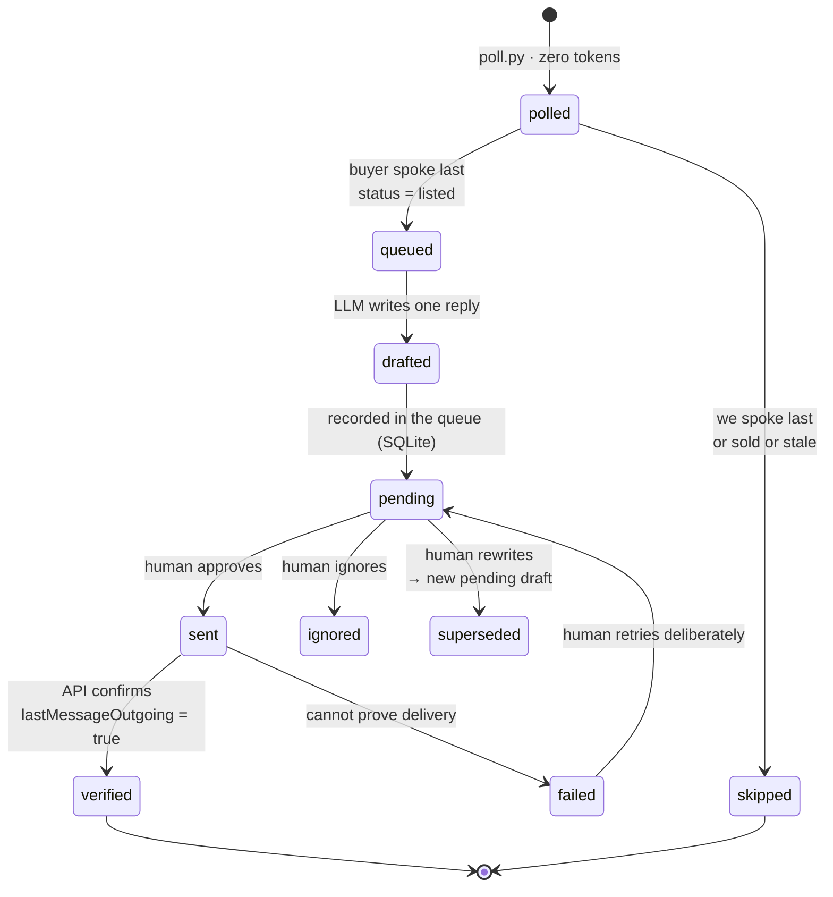
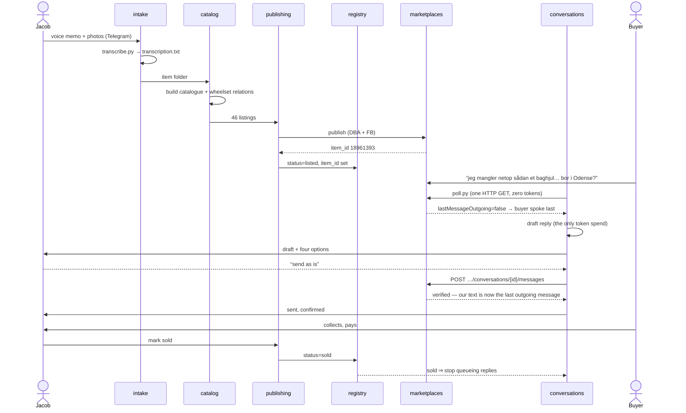

# Architecture

Second-hand marketplace ops, end to end: **materials in → listings out → buyer
conversations handled → item marked sold**, with a human approving anything that
reaches a stranger.

Every top-level directory under `src/` is a **node in the diagram below**, and the
directory name is identical to the node name. If you are looking at a folder, you
can find it in the diagram; if you are looking at a node, you know the folder.

| node | directory | one line |
|---|---|---|
| `intake` | `src/intake/` | turn voice memos, photos and text into a structured item folder |
| `catalog` | `src/catalog/` | build the item catalogue and the relations between items |
| `publishing` | `src/publishing/` | push listings to each marketplace and keep them in sync |
| `conversations` | `src/conversations/` | read buyer messages, draft, get approval, send, verify |
| `registry` | `src/registry/` | the single seam both halves agree on, plus the Notion mirror |
| `auth` | `src/auth/` | marketplace sessions — human logins only, never automated |

---

## 1. End-to-end pipeline



**Reading it as a pipeline of packages:** `intake` produces an item folder →
`catalog` turns folders into a catalogue → `publishing` puts the catalogue on the
marketplaces and writes `item_id` back into `registry` → `conversations` polls the
marketplaces for buyer messages, drafts, waits for the human, sends, and reads
`registry` so a sold item stops being answered.

---

## 2. `conversations` — the stage worth understanding

The only stage that spends tokens, and the only one allowed to talk to a stranger.



Five rules that are code, not intentions:

1. **Prime on first run** — an empty store records history and queues nothing.
2. **Age filter** — 14 days; a December thread is not news.
3. **Report the whole open queue** — a crashed drafting run cannot orphan a thread.
4. **Approval gate** — a draft leaves `pending` exactly once; deciding twice is refused.
5. **No auto-retry on an unverified send** — a retry can duplicate a message to a real person.

---

## 3. `registry` — the seam

`items.json` is the only thing `publishing` and `conversations` share.

```json
{"provider":"dba","item_id":"25983773","title":"Rear Wheel / Baghjul - 28\"",
 "price_dkk":150,"status":"listed","ad_url":"https://www.dba.dk/my-items/details/18961393",
 "created_at":"2026-10-24T09:12:00Z","status_changed_at":"2026-10-24T09:12:00Z"}
```

- **Join key:** `(provider, item_id)`. Nothing else — not the ad URL, not the title.
- **Statuses:** `draft · listed · reserved · sold · withdrawn`. Unknown values fail open for messaging and closed for selling.
- **Written by** `publishing` (atomically, via `os.replace`). **Read by** `conversations`, statelessly, once per tick.
- **`item_id` is only known after publish** — DBA assigns `itemInfo.itemId`. Rows with `status=draft` or `item_id=null` are skipped, never guessed.

The dangerous window is between "sold in the real world" and `status=sold` on disk.
A "still available?" message *after* a sale is the worst message this system can
send, which is why the transition must land within a minute.

---

## 4. Worked example — the bike parts, as actually sold

This is not a hypothetical. It is what ran on 2026-10-31.



---

## 5. Failure contract

Each stage fails in a way the next stage can see, never silently.

| stage | on failure | what it must NOT do |
|---|---|---|
| `intake` | leaves the item folder marked incomplete | invent a transcription |
| `catalog` | refuses to emit a half-built record | write a partial item |
| `publishing` | reports the ad that failed, keeps the rest | claim a listing exists |
| `conversations` poll | one line to stderr, exit 2 | wake the agent or message a human |
| `conversations` send | reports **failed**, records why | auto-retry, or claim success |
| `registry` | fails open for messaging, closed for selling | crash both halves |

---

## 6. Adding a marketplace

One provider file per stage, never a change to the pipeline:

```
src/publishing/providers/<name>.py     # post an ad
src/conversations/providers/<name>.py  # read threads, send a message
```

`providers/base.py` in each defines the methods. Facebook is stubbed in
`conversations/providers/fb.py` with the traps documented inline (virtualised
inbox, per-load `fb_dtsg`/LSD tokens, hard login wall).
