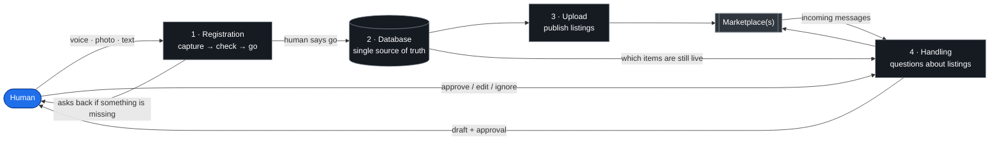
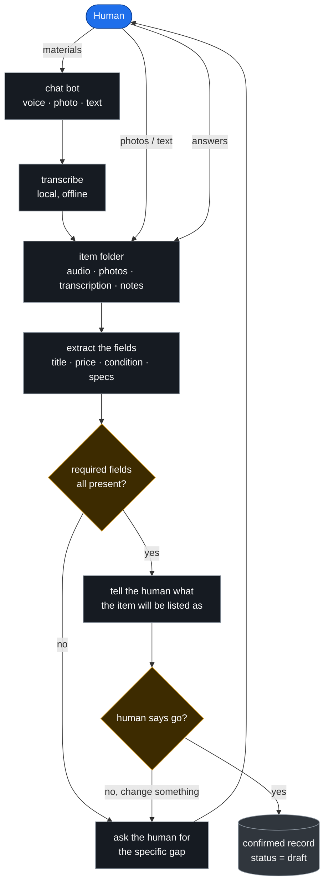
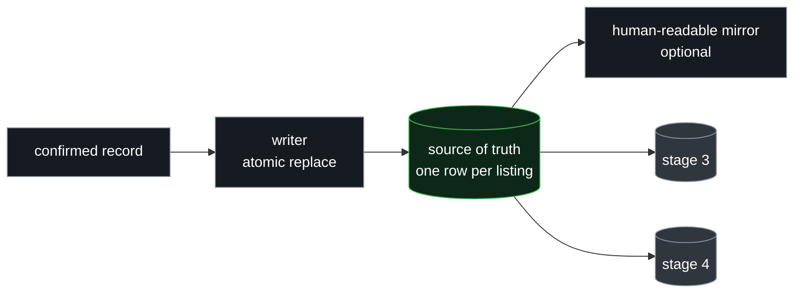
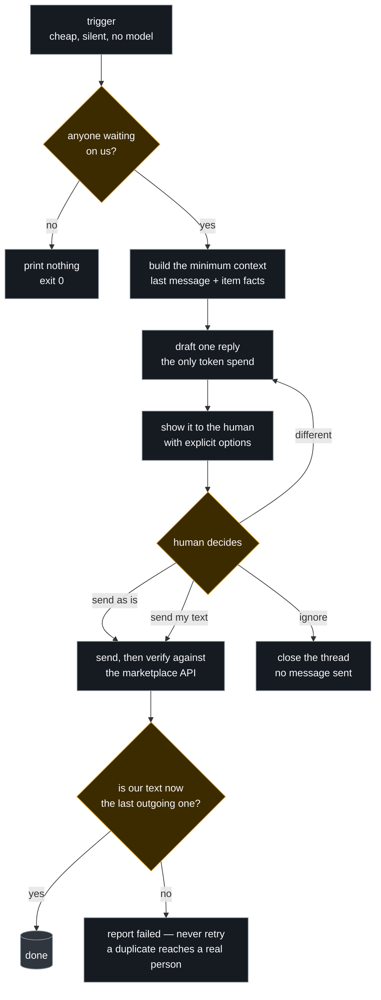
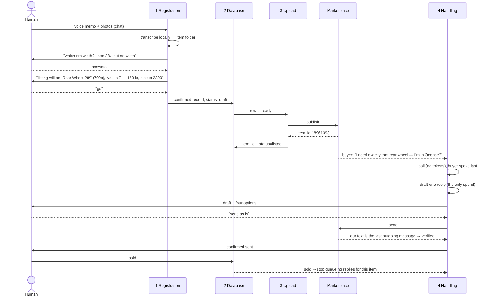

# Architecture

How materials become listings, and how messages about those listings get answered
without a human typing every reply.

**The top diagram has four stages.** Each stage boundary is a section below. Names
in the top diagram are **generic** — no marketplace, chat app or database appears
there. Every section then says *"in this implementation"* and names the exact
scripts, because an abstraction that never touches the concrete version is
unusable.

---

## 0. Overall architecture

**The human acts twice: at the start and before anything leaves.** Stage 1 is where
the human hands over materials *and* where the human decides the item is ready —
those are the same conversation, so they are the same stage. Every other step is
mechanical, which is why it can be scripted.

| stage | input | output | judgement? |
|---|---|---|---|
| 1 Registration | voice, photos, text | a confirmed record the human approved | **LLM + human** |
| 2 Database | confirmed record | one row, atomic, readable by everything | no |
| 3 Upload | rows marked ready | live listings with external ids | no |
| 4 Handling | incoming messages | replies, only after approval | **LLM + human** |

**Every arrow is a hard boundary** — a file, a row, a message — never a function
call. That is what lets someone replace one stage and keep the rest, and it is the
main design claim in this document.

---

## 1. Registration — capture, check, and get a go-ahead

**Contract:** nothing is interpreted silently. The agent extracts what it can, then
either says exactly what is missing or shows the human what the listing will
become — and the human says go. **A record only leaves this stage on the human's
word, never on the agent's confidence.**

The required-fields list is **configuration, not prompt text**: a marketplace that
needs different fields changes the list, not the model. That is what keeps this
stage portable across marketplaces.

Two failure modes this ordering prevents:

- **Asking too early.** Demanding a field the marketplace does not need wastes the
  human's attention and teaches them to ignore the questions.
- **Listing on a guess.** An LLM can misread a wheel size or a groupset. Caught here
  it costs one message; caught after a buyer has driven across town it costs trust.

> **In this implementation:** the human messages a Telegram bot with voice notes,
> photos or text. `src/intake/transcribe.py` runs Whisper locally — CPU, no API
> key, nothing uploaded — and writes `transcription.txt` beside the audio.
> `src/catalog/build_catalog.py` and `inventory_relations.py` turn the folder into
> the structured record and the wheelset ↔ wheel relations; the required-field
> list lives there, next to the fields themselves. The human's confirmation is a
> plain reply in the same chat — no forms, no UI. A worked folder is committed at
> `examples/items/P01/`.

---

## 2. Database — one row, one truth

**Contract — the join key is `(provider, item_id)` and nothing else.** Not a URL,
not a title: those change or duplicate. Statuses are exactly five words —
`draft · listed · reserved · sold · withdrawn` — and an unknown status fails
**open** for messaging (answer anyway) and **closed** for selling (never
double-sell).

**Writes happen in one place only.** Everything else reads. That asymmetry is what
makes the system debuggable: if a row is wrong, exactly one writer wrote it.

> **In this implementation:** the human-readable source of truth is a Notion page
> database, mirrored into `items.json` by `src/registry/notion_ssot.py`; the store
> is `src/registry/registry.py`, writing atomically via `os.replace` so a reader
> sees either the old file or the new one, never half a row. Stage 4 gets a
> **read-only** door (`src/conversations/registry.py`) — the messaging side is
> structurally incapable of writing the seam.

---

## 3. Upload — put it on the marketplace and get an id back

**Contract:** `item_id` is usually **only known after publishing** — the
marketplace assigns it. Until then the row has no join key, and stage 4 must skip
it rather than guess which item a buyer means.

Two rules that cost real money to learn: publish in a batch but **record per
listing**, so one failure cannot orphan the others; and never claim a listing
exists because a request returned success — re-read it.

> **In this implementation:** `src/publishing/batch_publisher.py` posts to DBA and
> Facebook through `src/publishing/providers/`. Credentials come from a **human
> login done once** in a headed browser (`src/auth/login_marketplace.py`), then a
> cookie jar imported by `src/auth/import_cookies.py`; no credential is ever
> automated. DBA returns `itemInfo.itemId`, written straight back into the
> registry. Live-ad repairs: `fix_past_dba_listings.py`, `update_crosslinks_dba.py`.

---

## 4. Handling — messages in, approved replies out

**Contract:** the human is the only sender. The system's job is to make deciding
fast — a draft, the context, four options — and to prove what actually left.

> **In this implementation:** `src/conversations/poll.py` is the trigger; drafts and
> approvals go through `src/conversations/msgctl.py`, and replies are handed to the
> human on Telegram by `notify.py` with the four options
> `1 send as is · 2 send what I write · 3 ignore · 4 other`. Sending is
> `providers/dba.py::send`, which verifies by re-reading the API — a 200 is not
> accepted as proof. Endpoints and the three rules for trusting a send:
> [`DBA-API.md`](DBA-API.md).

---

## 5. Why this burns few tokens

The design rule: **anything deterministic is a script; the model only judges.**

| step | cost | how |
|---|---|---|
| trigger | **0** | one authenticated HTTP GET; prints nothing when nothing is new |
| change detection | **0** | a hash of the trigger's own output — identical output means the agent never wakes |
| dedupe | **0** | content hashes in SQLite, so a re-poll cannot re-queue |
| state | **0** | SQLite; nothing lives in a prompt, no history is re-sent for memory |
| draft | **one short call** | only the last message plus item facts, not the whole thread |
| approval | **0** | four fixed options; the answer is routed by a state machine, not prose parsing |
| send + verify | **0** | HTTP request, then a read to confirm |

The expensive failure mode in systems like this is not the model — it is waking it
every few minutes to re-read a world that has not changed. Here a script polls the
world and the model is woken only when the script's output *changes*.

---

## 6. Worked example — the bike parts, as actually sold

Real run, 2026-10-31. The generic stages from §0, with this implementation's names.

---

## 7. Where each stage lives

Directories are named after the stage they implement, so the tree and the diagram
agree. Two directories serve stage 1 because capture and structuring genuinely
split there.

| stage | directories | entry points |
|---|---|---|
| 1 Registration | `src/intake/` + `src/catalog/` | `transcribe.py`, `build_catalog.py`, `inventory_relations.py` |
| 2 Database | `src/registry/` | `registry.py`, `notion_ssot.py` |
| 3 Upload | `src/publishing/` | `listctl.py`, `batch_publisher.py`, `providers/` |
| 4 Handling | `src/conversations/` | `poll.py`, `msgctl.py`, `providers/` |
| credentials (cross-cutting) | `src/auth/` | `login_marketplace.py`, `import_cookies.py` |

Adding a marketplace touches `providers/` in stages 3 and 4 and nothing else.
